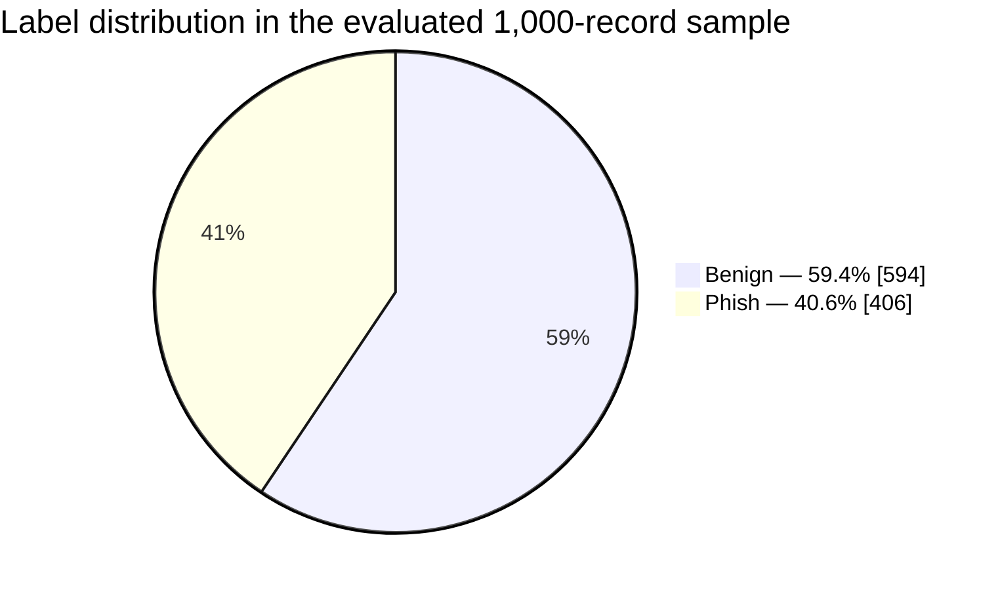
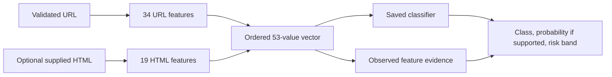
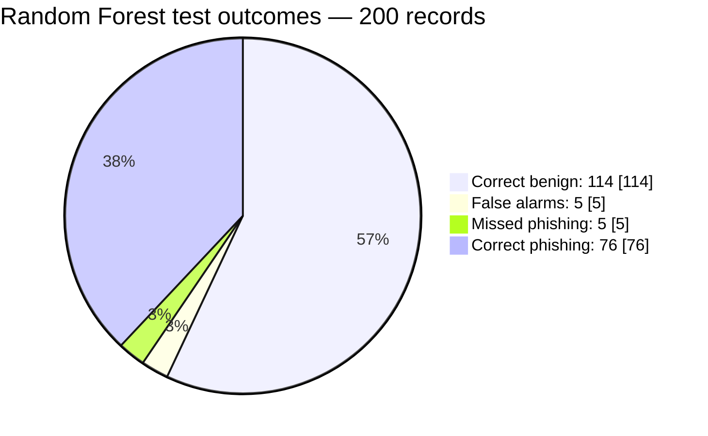
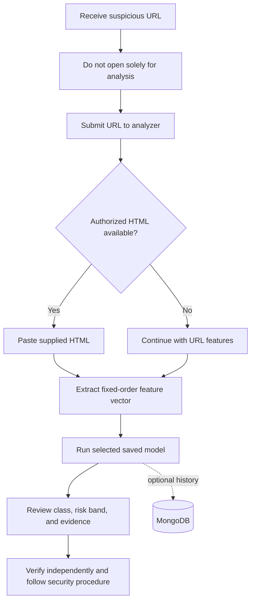
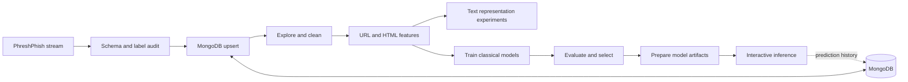
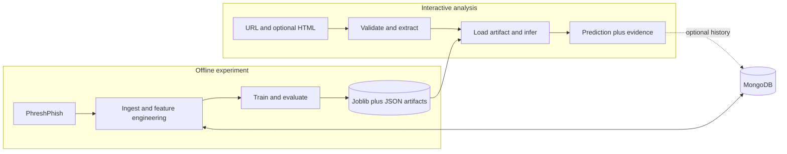

  
   
  
  
  
  
  
  

 

  <b>Intelligent_URL_Threat_analyzer</b> 
  Inspect the link. Review the evidence. Keep the decision human.

<h2 align="center"></h2>

A message arrives with a link that looks familiar. The wording is urgent, the destination is one click away, and there is little time to decide. That is exactly when a closer look matters. A URL is a small artifact, but its hostname, path, and wording may preserve clues about the page waiting behind it.

**Intelligent_URL_Threat_analyzer** begins with a practical question: *before following a suspicious link, what can we learn from the link itself?* The answer is not certainty. It is a structured inspection: extract measurable characteristics, compare them with labeled examples, and show the observations so a person can decide what deserves further investigation.

<h2 align="center"></h2>

Phishing uses deception to move a person from a trusted context—an inbox, a message, a familiar brand—to a destination controlled by someone else. The link is often the transition point. Its appearance can imitate a legitimate service, while subtle differences in domain structure or path text may be worth reviewing.

This project focuses on that transition because it is concrete and inspectable. HTTPS does not establish trust, suspicious-looking text does not establish guilt, and a model cannot observe intent from a URL alone. The objective is to support cautious review, not to replace it with an automated verdict.

<h2 align="center"></h2>

The Streamlit application accepts an HTTP or HTTPS URL, optional HTML supplied by the user, and a selected saved classifier. It validates the URL, derives URL and HTML features, runs inference, and displays a class, probability where the model supports it, a risk band, and non-zero feature evidence.

The application does **not** request the destination, fetch its HTML, follow redirects, render JavaScript, inspect DNS or TLS, or query a live reputation service. Optional HTML must already be available to the user through an authorized process. This boundary is central to interpreting the output: the model analyzes submitted material, not the current live website.

  
  
  

<h2 align="center"></h2>

The project uses [PhreshPhish](https://huggingface.co/datasets/phreshphish/phreshphish), identified by the dataset ID `phreshphish/phreshphish`. Its source labels are retained as `benign` and `phish`, then mapped to two numeric classes for learning. The dataset provides URL records and associated fields, including HTML where available.

Ingestion streams records from Hugging Face into local or self-hosted MongoDB and upserts them by SHA-256, so repeated ingestion does not simply append duplicate copies. The project identifies the dataset as [CC BY 4.0](https://creativecommons.org/licenses/by/4.0/); use the dataset card and [paper](https://arxiv.org/abs/2507.10854) for provenance and attribution.

The evaluated sample contains **1,000 records**: **594 benign (59.4%)** and **406 phish (40.6%)**. A stratified split allocated **800 records for training** and **200 for testing**. The test subset contains **119 benign** and **81 phish** records. These counts describe the experiment, not the total size of PhreshPhish.

  
  
  

<h2 align="center"></h2>

The current inference contract is a fixed-order vector of **53 deterministic numeric features**. The URL extractor contributes **34 features** covering URL, host, path, and query lengths; punctuation; IP-address hosts; HTTPS; subdomain depth; shortened domains; suspicious TLD heuristics; and credential- or finance-related keywords.

The HTML extractor contributes **19 features** covering forms, input types, password fields, links, images, scripts, iframes, titles, metadata, favicons, login-form patterns, and selected JavaScript cues. When HTML is absent, these page features are zero-filled. Extractors are shared across training and inference so feature order does not drift between the offline experiment and the running application.

These values encode observations, not intent. A password input is common on legitimate services; a suspicious TLD is not proof of phishing; and the absence of a heuristic signal is not evidence of safety.

<h2 align="center"></h2>

The offline bench compares Logistic Regression, Linear SVC, Random Forest, Extra Trees, Histogram Gradient Boosting, and XGBoost on the URL-plus-HTML feature matrix. This gives the experiment linear, bagged-tree, and boosted-tree approaches to compare; it does not imply every model performs equally well or that one algorithm is universally best.

Model fitting and selection happen offline. The Streamlit application loads saved model artifacts and their metadata; it does not retrain at startup. Metadata preserves the label mapping, ordered feature names, model version, and threshold needed to interpret inference. Separate text experiments examine word/character TF-IDF, bag-of-words, and lexical features; those representations are not connected to the current app inference path.

  
  
  
  
  
  

<h2 align="center"></h2>

At the default threshold of **0.5**, the saved Random Forest test report gives **0.950 accuracy**, **0.948 balanced accuracy**, **0.938 precision for phish**, **0.938 recall for phish**, **0.938 phish F1**, **0.992 ROC-AUC**, and **0.988 PR-AUC**. Its test confusion matrix is `[[114, 5], [5, 76]]`, with actual labels as rows (`benign`, `phish`) and predicted labels as columns.

| Evaluation context | Saved value |
| --- | ---: |
| Training records | 800 |
| Test records | 200 |
| Test class support | 119 benign, 81 phish |
| Test accuracy | 0.950 |
| Test balanced accuracy | 0.948 |
| Test phishing recall | 0.938 |
| Test phishing F1 | 0.938 |
| Test ROC-AUC / PR-AUC | 0.992 / 0.988 |

Across the **200 test cases**, the model classified **190 correctly (95%)** and **10 incorrectly (5%)**. Five benign records were flagged as phish, a **4.2% false-positive rate** among the 119 benign cases; five phishing records were classified as benign, a **6.2% false-negative rate** among the 81 phishing cases. Those errors have different consequences, so accuracy alone is not enough.

This is a small experiment—not a deployment benchmark, a guarantee of detection, or a measurement of all URLs in the wild. Performance can change with sampling, distribution shift, labels, and threshold selection. Read the metrics alongside the sample size and class counts rather than as a stand-alone promise.

  
  
  
  

<h2 align="center"></h2>

The classifier returns a binary label: `benign` or `phish`. If the selected estimator exposes probability estimates, the application uses the saved threshold—normally **0.5**—to determine that class. The user interface separately maps the estimated phishing probability to risk bands: below **0.35** is **Benign**, above **0.65** is **Phishing**, and the interval from **0.35** through **0.65** is **Uncertain**.

Because class threshold and risk-band cutoffs are different, a binary class and displayed risk band can disagree. Linear SVC has no probability output in the current inference path, so its result cannot provide `P(phish)`; the risk display falls back to its predicted class. The application does not claim calibrated probabilities. Evidence lists observed non-zero features; it does not establish which feature caused a decision or prove a site's intent.

<h2 align="center"></h2>

The analyst workflow starts with a URL that should not be opened merely to satisfy curiosity. The user submits the address, optionally adds HTML already obtained with authorization, selects a model, and reviews both the output and its evidence. MongoDB availability controls dataset-backed pages and prediction-history persistence; the sidebar reports database status.

<h2 align="center"></h2>

The model lifecycle is intentionally separate from live analysis. Dataset review and ingestion feed exploration and feature extraction; candidate models are trained and evaluated offline; model artifacts and metadata are then prepared for interactive inference. Bounded samples are useful when validating an experiment. MongoDB must be running for ingestion and database-backed training.

The text-representation comparison is a separate research track; the deployed analyzer uses the URL-plus-HTML feature contract. Keeping those paths distinct makes it clear which experiment produced the model used for a prediction.

<h2 align="center"></h2>

Offline training produces serialized models, metadata, evaluation results, and an artifact inventory. Online inference validates input, invokes the same feature definitions in the training order, loads a saved model, and returns the prediction with observed evidence. It does not fit models during app startup or prediction.

MongoDB stores source records, derived features, model metadata, evaluation summaries, and optional prediction history. It is configured for local or self-hosted use. The exported experiment identifies Random Forest as selected, while the analyzer initially prefers Logistic Regression when available. Choose the model in the interface rather than assuming those defaults are synchronized.

<h2 align="center"></h2>

The application is designed for Python **3.10 or newer**, Streamlit, classical machine-learning estimators, and optional local or self-hosted MongoDB. Model inference requires saved model artifacts. MongoDB enables dataset-backed views, ingestion, and prediction-history persistence. The interface is an analyst-facing view over offline-trained models, not a live protective gateway.

**Use the result as triage, never as authorization to click.** A Benign prediction is not a safety guarantee; a Phishing prediction is not proof of intent. Do not submit data unless you are authorized to handle it. Prediction history may persist in MongoDB. Verify consequential decisions using independent evidence and established security procedures.

  
  

 

  
  

