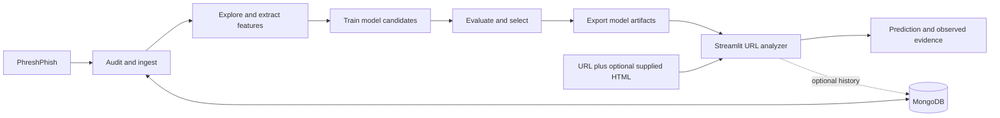

<div align="center">
  
  <br>
  
  
  
  
</div>

<br>

<div align="center">
  <b>A phishing link wants you to act quickly. This project asks you to take a closer look first.</b>
</div>

<h2 align="center"></h2>

An ordinary message arrives. The link looks familiar, the wording sounds urgent, and the fastest answer is one click away. But what if that click is exactly what the sender is counting on?

**Intelligent_URL_Threat_analyzer** grew from that pause: the wish to examine a suspicious link before trusting it. The name carries the ambition; the project keeps the promise modest. It looks for clues, shows its work, and leaves the final call to a human. The link can be dramatic enough for both of us.

<h2 align="center"></h2>

Phishing turns a small everyday action into an opening for harm. A URL is often the first clue someone can inspect without visiting the destination. Its hostname, path, and wording may be revealing—or perfectly ordinary. That uncertainty is the point: help people ask better questions, not hand them a green light to click.

<h2 align="center"></h2>

Submit an HTTP or HTTPS URL, optionally add HTML you are authorized to inspect, and choose a saved model. The app returns a classification, probability where supported, a risk band, and observed feature evidence. It does **not** visit the URL, fetch page contents, follow redirects, or check live reputation.

<h2 align="center"></h2>

The project uses [PhreshPhish](https://huggingface.co/datasets/phreshphish/phreshphish), preserving its `benign` and `phish` labels. Records are streamed into local or self-hosted MongoDB and upserted by SHA-256. The checked-in Random Forest experiment used **1,000 examples**: **800** for training and **200** for testing.

<div align="center">
  
  <a href="https://huggingface.co/datasets/phreshphish/phreshphish"></a>
  <a href="https://creativecommons.org/licenses/by/4.0/"></a>
</div>

<h2 align="center"></h2>

The analyzer builds **53 deterministic features**: **34** from URL structure and wording, and **19** from optional HTML structure. It measures things such as hostname depth, suspicious terms, password fields, forms, and external links. No HTML? The page-feature slots stay empty. A password box is a clue, not a confession.

<h2 align="center"></h2>

Six classical models take their turn: Logistic Regression, Linear SVC, Random Forest, Extra Trees, Histogram Gradient Boosting, and XGBoost. They are compared offline; the app loads saved artifacts and does not train while you wait. Text experiments with TF-IDF and lexical features are a separate track, not inputs to the current analyzer.

<h2 align="center"></h2>

The saved Random Forest test report records **0.950 accuracy**, **0.938 phishing recall**, and **0.988 PR-AUC** on **200 test records**. Those are results from one small experiment—not a promise about the next link in your inbox. New data, new thresholds, and real-world conditions can change the story.

<div align="center">
  
  
  
</div>

<h2 align="center"></h2>

When probability is available, the interface labels values below **0.35** Benign, above **0.65** Phishing, and the space between them Uncertain. The model's binary class uses its own threshold, so the two displays can differ. Linear SVC has no probability output in the current inference path. “Uncertain” is a useful pause—not a mathematical force field.

<h2 align="center"></h2>

The research path begins with a dataset audit, moves through ingestion and feature extraction, then trains and evaluates models. Exported artifacts feed the interactive analyzer. MongoDB supports the data workflow and optional prediction history; it is not part of model fitting at prediction time.



<h2 align="center"></h2>

Use Python 3.10 or newer. From the repository root, install dependencies and launch the app:

```powershell
py -3 -m venv .venv
.\.venv\Scripts\Activate.ps1
pip install -r requirements.txt
streamlit run app.py
```

The app normally opens at `http://localhost:8501`. MongoDB is required for dataset-backed views and prediction history. Configure a local or self-hosted instance with `MONGO_URI` and `MONGO_DB_NAME` in a root `.env` file. Saved model artifacts are required for inference.

<h2 align="center"></h2>

**Benign does not mean safe. Phishing does not mean proven.** Do not open a suspicious URL just to collect HTML, and do not submit data unless you are authorized to handle it. Prediction history may be stored in MongoDB. Use the result as one clue, verify important decisions independently, and follow your organization's security process.

<div align="center">
  
</div>

<h2 align="center"></h2>

<div align="center">
  <a href="docs/features.md"></a>
  <a href="docs/architecture.md"></a>
  <a href="docs/evaluation_report.md"></a>
  <a href="https://huggingface.co/datasets/phreshphish/phreshphish"></a>
</div>

<br>

<div align="center">
  <sub>Built for the moment before the click. Keep that moment.</sub>
</div>
